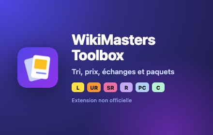

# WikiMasters Toolbox



Extension de navigateur **non officielle** pour [WikiMasters](https://www.wiki-masters.com/), faite par des joueurs pour des joueurs : tri automatique des cartes, prix du marché, échanges, paquets et familles, directement dans les pages du site.

*[English summary below](#english)*

---

## Fonctionnalités

- **Tri automatique** : un thème par carte (Histoire, Sciences, Sports, Pop-Culture…) posé en étiquette WikiMasters, l'étiquette `Doublon` sur les cartes en plusieurs exemplaires, et une étiquette « Pour : pseudo » pour chaque ami qu'une carte intéresse. Aperçu avant chaque tri ; vos étiquettes personnelles et vos corrections ne sont jamais touchées.
- **Prix** : prix du marché de chaque carte dans sa rareté (médiane des dernières ventes, prix à part pour les shiny, « ≈ » quand la carte s'est vendue trop peu de fois ; minimum de ventes et premières ventes ignorées réglables), affiché sur les cartes du site, dans leur fiche et sur les enchères. Valeur de votre collection, classement de vos cartes les plus chères, et filtres de toute la collection, cumulables (doublons, sans image, GIF) et par vente (jamais vendues, vendues entre X et Y ₩), affinés par mots-clés à inclure ou exclure, sur la page Collection et dans l'onglet Prix : les cartes trouvées se mettent aux enchères ou se défaussent une à une ou en lot.
- **Marché** : pastilles « bonne affaire » et « trop cher », suivi de vos enchères avec surenchère en un clic et alerte avant la fin, vente ou défausse de vos doublons.
- **Échanges** : profils d'intérêts partageables par code ; sur le profil d'un ami, ses cartes qui vous intéressent, les vôtres qui l'intéressent, et une offre équilibrée en prix du marché. Valeur de chaque côté des échanges en cours.
- **Paquets** : récapitulatif après chaque paquet (nouveautés, doublons, prix, valeur totale) où les cartes cochées se défaussent ensemble pour 1 WikiBidou chacune et où chaque carte se met aux enchères, « Ouvrir le prochain » pour enchaîner les paquets, taux de drop par rareté, « Tout ouvrir » sur votre clic.
- **Familles** : groupes de cartes à compléter, choisies une à une ou remplies par une recherche, avec les cartes manquantes en vente.
- **Images** : n'afficher que vos cartes sans image, ou celles dont l'image est un GIF, sur toute la collection (onglet Images et page Collection).
- **Sur les cartes** : un nouvel affichage, avec l'image sur toute la carte et un cadre aux couleurs de la rareté ; les images manquantes cherchées sur Wikimedia ; thème, prix, possédée ou nouvelle, lien vers l'article Wikipédia.

Chaque fonction se désactive dans les réglages. Rien n'est écrit sur votre compte sans un clic de votre part, et aucune donnée ne quitte votre navigateur en dehors de WikiMasters.

**Tout est expliqué dans le [guide de l'utilisateur](docs/guide.md).**

---

## Installation

**Chrome, Edge, Brave, Opera** : installez *WikiMasters Toolbox* depuis le Chrome Web Store, puis rechargez wiki-masters.com. L'entrée **Toolbox** apparaît dans le menu du site, et l'icône de l'extension ouvre les actions rapides.

**Depuis le code source** (Chrome 120+ ou Firefox 128+) :

1. `npm install`, puis `npm run build`.
2. Chrome et dérivés : `chrome://extensions` → *Mode développeur* → *Charger l'extension non empaquetée* → dossier `dist/chrome`.
   Firefox : `about:debugging#/runtime/this-firefox` → *Charger un module complémentaire temporaire* → `dist/firefox/manifest.json`.
3. Rechargez wiki-masters.com.

---

## Vos données

L'extension n'a ni serveur, ni compte, ni publicité, ni statistiques d'usage. Elle utilise votre session WikiMasters pour parler à WikiMasters, comme le site lui-même, et garde tout le reste dans votre navigateur. Voir la [politique de confidentialité](PRIVACY.md).

---

## Documentation

| Document | Pour qui | Contenu |
|---|---|---|
| [Guide de l'utilisateur](docs/guide.md) | Joueurs | Chaque fonction, page par page et onglet par onglet, réglages, questions fréquentes |
| [Scripts Node](docs/scripts.md) | Joueurs avancés | Trier et chercher des échanges en ligne de commande, faire évoluer les règles de tri |
| [Structure du projet](docs/architecture.md) | Contributeurs | Arborescence commentée, moteur, extension, tests, build |
| [Routes du site](docs/site-api.md) | Contributeurs | API de wiki-masters.com utilisée par l'extension |
| [Cahier des charges](docs/cahier-des-charges.md) | Contributeurs | Décisions, principes, fonctionnalités prévues et réalisées |
| [AGENTS.md](AGENTS.md) | Agents IA et contributeurs | Règles du projet, fonctionnement du tri, charte graphique |
| [Publication](store/README.md) | Mainteneurs | Mise en ligne sur le Chrome Web Store |

---

## Développement

```bash
npm install
npm run watch   # build continu dans dist/
npm test        # tests du moteur et de l'extension, sans réseau
npm run eval    # qualité du classement sur le jeu de cartes étiquetées
```

Le dépôt contient un moteur de tri partagé (`core/`), l'extension (`extension/`), des scripts Node (`scripts/`) et les tests (`tests/`) : voir la [structure du projet](docs/architecture.md). Un problème ou une idée : [issues](https://github.com/LeadOn/Wikimasters-card-sorter/issues).

---

## English

WikiMasters Toolbox is an **unofficial** browser extension for [WikiMasters](https://www.wiki-masters.com/), made by players for players. Right inside the site's pages, it adds:

- **Automatic sorting**: one theme per card stored as a WikiMasters tag, a `Doublon` tag on cards you own more than once, and a "Pour : name" tag for each friend a card would interest. Every sort is previewed first; your own tags and manual fixes are never touched.
- **Prices**: average sale price of each card in its rarity, on cards, in their detail window and on auctions; collection value and most valuable cards.
- **Market**: "good deal" and "overpriced" badges, your auctions with one-click outbid and an ending alert, selling or discarding your duplicates.
- **Trades**: shareable interest profiles; on a friend's profile, the cards you want from them, the cards they want from you, and a balanced offer.
- **Packs**: a recap after each pack (new cards, duplicates, prices, total value) where each card can be put up for auction or discarded for 1 WikiBidou, drop rates, and "Open all" on your click.
- **Families**: sets of cards to complete, hand-picked or filled from a search.
- **Cards**: a new card layout with a full-bleed image and a rarity-colored frame; missing images looked up on Wikimedia.

Every feature can be turned off. Nothing is written to your account without a click, there is no third-party server, and your data stays in your browser ([privacy policy](PRIVACY.md)). The interface and documentation are in French: see the [user guide](docs/guide.md).

To build from source: `npm install && npm run build`, then load `dist/chrome` as an unpacked extension (`chrome://extensions`, developer mode) or `dist/firefox/manifest.json` as a temporary add-on in Firefox 128+.
